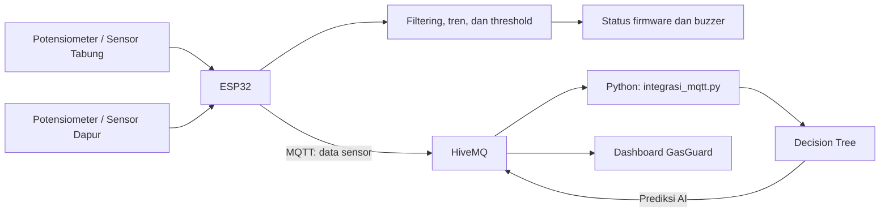

# GasGuard - Sistem Deteksi Kebocoran Gas LPG Berbasis IoT 
Mencegah terjadinya kebocoran gas dengan pemantauan dua titik secara berkala dan analisis tren
---
<p> Risiko kebocoran gas LPG senantiasa mengintai di lingkungan rumah tangga. GasGuard terinspirasi dari penelitian terdahulu yang telah mengembangkan deteksi das menggunakan sensor MQ-6, ESP32, alarm, dan notifikasi jarak jauh. Proyek ini berfokus pada pengembangan sistem yang dapat mengolah dan membandingkan pembacaan sensor dari dua titik berbeda demi meningkatkan akurasi. </p>

## Rancangan Sistem
Adapun sistem GasGuard dirancang terdiri dari:
<ol>
  <li><p><i> Edge Device:</i></p>
    <ol>
    <li> <p>ESP32 sebagai "otak" perangkat yang membaca input sensor, memproses data, mengambil keputusan, dan mengirim data ke <i>cloud.</i></p> </li>
    <li> <p>HP Android sebagai perangkat yang  meneruskan data sensor dan menampilkan informasi sensor ke pengguna melalui <i>dashboard.</i> </p></li>
    </ol>
  </li>
  <li> <p>2 Buah Sensor MQ-6 di dua titik pemantauan yang berbeda, yaitu di area tabung gas dan ruangan dapur.</p>
  </li>
  <li> <p>Alarm <i>(buzzer)</i> sebagai aktuator yang  memberikan peringatan suara berdasarkan keputusan ESP32.</li></p>
  <li> <p>Komunikasi melalui WiFi dan MQTT.</p></li>
  <li> <p><i>Cloud</i> sebagai penerima dan penerus data sensor.</p></li>
</ol>
<p>Simulasi Sistem GasGuard menggunakan Wokwi dan PlatformIO. Sistem juga menggunakan <i>Moving Median</i> dan <i>Decision Tree Algorithm </i> dalam menentukan status dari pembacaaan sensor, yaitu AMAN, WASPADA, atau BAHAYA. Terdapat pula model yang dikembangkan untuk melakukan hal yang sama berdasarkan input pembacaan sensor yang dilatih menggunakan sekumpulan dataset berlabel skenario tertentu. Semua hasil tersebut akan ditampilkan pada <i>dashboard android</i>. </p>

>Pada simulasi, potensiometer digunakan sebagai pengganti nilai keluaran sensor gas analog. asil simulasi belum membuktikan kemampuan mendeteksi kebocoran LPG menggunakan sensor MQ-6 fisik. Nilai ADC juga bukan konsentrasi gas dalam ppm.

## Cara kerja



GasGuard memiliki dua hasil klasifikasi yang ditampilkan secara terpisah:

- **Status firmware:** ditentukan oleh threshold dan analisis tren pada ESP32; status ini tetap mengendalikan buzzer.
- **Prediksi AI:** dihasilkan oleh model Decision Tree di Python dan ditampilkan sebagai informasi tambahan pada dashboard.

## 1. Jalankan ESP32 melalui Wokwi

Buka folder `Projects-GasGuard` di VS Code, lalu jalankan simulasi Wokwi. Firmware membaca dua input, menerapkan Moving Median Filter, menghitung tren, menentukan status, mengendalikan buzzer, dan mengirim data ke HiveMQ.

- Broker: `broker.hivemq.com`
- Port ESP32: `1883`
- Topic sensor: `gasguard/kelompok8/device01/sensor/data`

## 2. Jalankan integrasi AI di laptop

Gunakan Python dan virtual environment. Dari folder `Projects-GasGuard`, aktifkan environment yang sudah dibuat, lalu pasang dependency:

```powershell
C:\venvs\gasguard\Scripts\Activate.ps1
python -m pip install -r .\ai_model\requirements.txt
```

Salin konfigurasi contoh menjadi `.env`:

```powershell
Copy-Item .\ai_model\.env.example .\ai_model\.env
```

Jalankan program integrasi:

```powershell
python .\ai_model\integrasi_mqtt.py
```

Program memuat `decision_tree_model.pkl`, menerima data sensor dari MQTT, membentuk fitur model, menjalankan prediksi, mencatat hasil ke `ai_model/ai_prediction_log.csv`, lalu mengirim prediksi ke topic AI.

## 3. Input dan output Decision Tree

Model menggunakan lima fitur dengan nama dan urutan berikut:

1. `filter_tabung`
2. `filter_dapur`
3. `selisih_sensor`
4. `tren_tabung`
5. `tren_dapur`

Python mengambil nilai filter dan tren dari payload ESP32. `selisih_sensor` dihitung ulang dengan rumus `filter_tabung - filter_dapur` agar konsisten dengan feature engineering dataset.

Output model adalah salah satu kelas: **AMAN**, **WASPADA**, atau **BAHAYA**.

## 4. Buka dashboard

Buka `dashboard/index.html` menggunakan Live Server di laptop. Dashboard berlangganan dua topic:

| Topic | Data |
|---|---|
| `gasguard/kelompok8/device01/sensor/data` | Pembacaan sensor dan status firmware dari ESP32 |
| `gasguard/kelompok8/device01/ai/prediction` | Hasil prediksi Decision Tree dari Python |

Untuk membuka dashboard di HP Android tanpa mengakses server laptop melalui jaringan lokal, salin `dashboard/index.html` ke HP, lalu sajikan file tersebut menggunakan server lokal Termux:

```bash
pkg install python
termux-setup-storage
cd ~/storage/downloads/GasGuard
python -m http.server 5500 --bind 127.0.0.1
```

Buka `http://127.0.0.1:5500` di browser HP. Pastikan file `index.html` berada di folder yang sedang disajikan Termux. Laptop tetap menjalankan Wokwi dan `integrasi_mqtt.py`; HP hanya membuka dashboard.

## File utama

- `Projects-GasGuard/src/main.cpp` — firmware ESP32.
- `Projects-GasGuard/dataset/` — dataset dan hasil feature engineering.
- `Projects-GasGuard/ai_model/decision_tree_model.pkl` — model hasil training Anggota 2.
- `Projects-GasGuard/ai_model/integrasi_mqtt.py` — integrasi MQTT dan prediksi AI oleh Anggota 3.
- `dashboard/index.html` — dashboard monitoring GasGuard.

><p>Untuk dokumentasi selengkapnya, dipersilakan untuk mengecek dokumentasi tambahan pada folder <i>docs</i>, seperti `docs/ARCHITECTURE.md`, `docs/SETUP.md`, `docs/DASHBOARD.md`, dan `docs/hasil-pengujian.md`.</p>

