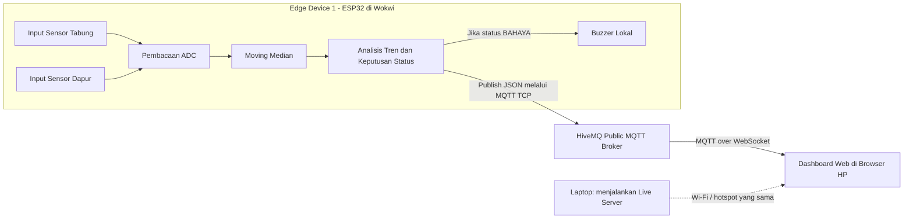

# Arsitektur Sistem GasGuard

## 1. Gambaran Umum

GasGuard merupakan sistem pemantauan gas LPG berbasis IoT yang menggunakan ESP32 untuk membaca dua input sensor, memproses data, dan mengaktifkan buzzer lokal saat kondisi memenuhi kriteria bahaya.

Data yang telah diproses dikirim melalui MQTT ke broker publik HiveMQ, kemudian ditampilkan pada dashboard web yang dapat diakses melalui HP Android.

## 2. Diagram Arsitektur

## 3. Alur Kerja Sistem

1. Dua input sensor gas disimulasikan menggunakan potensiometer di Wokwi.
2. ESP32 membaca nilai ADC dari kedua input.
3. Algoritma moving median menyaring perubahan data agar pembacaan lebih stabil.
4. Analisis tren dan algoritma pengambilan keputusan menentukan status sistem.
5. Buzzer lokal diaktifkan sesuai logika pada firmware.
6. Data sensor yang sudah diproses dikirim ke broker MQTT HiveMQ.
7. Dashboard menerima pesan MQTT dan menampilkan nilai kedua titik sensor serta status sistem secara real-time.

## 4. Komponen dan Fungsinya

| Komponen | Fungsi |
|---|---|
| ESP32 | Membaca input sensor dan menjalankan pemrosesan data |
| Potensiometer 1 | Simulasi input sensor di area tabung |
| Potensiometer 2 | Simulasi input sensor di area dapur |
| Buzzer | Memberikan alarm lokal |
| Moving Median | Menyaring noise pada pembacaan sensor |
| Analisis Tren | Menganalisis perubahan nilai dan menentukan status |
| HiveMQ | Meneruskan pesan MQTT antara publisher dan subscriber |
| Dashboard Web | Menampilkan data sensor dan status sistem pada HP Android |

## 5. Komunikasi MQTT

ESP32 mengirim data menggunakan MQTT TCP melalui port 1883. Dashboard browser menerima data melalui MQTT over WebSocket.

Konfigurasi yang digunakan:

- Broker: `broker.hivemq.com`
- Topic: `gasguard/sensor/data`
- Publisher: ESP32 di Wokwi
- Subscriber: Dashboard web
- Field JSON: `titik1`, `titik2`, dan `status`

## 6. Jaringan dan Edge Device

ESP32 dijalankan melalui simulasi Wokwi, sedangkan dashboard dibuka pada HP Android menggunakan browser.

Untuk demonstrasi, laptop yang menjalankan dashboard dan HP Android dihubungkan ke Wi-Fi atau hotspot yang sama. HP mengakses halaman dashboard melalui alamat IP lokal laptop.

Pengiriman data sensor tetap melewati broker MQTT melalui internet. Dengan demikian, jaringan lokal digunakan untuk mengakses halaman dashboard, sedangkan MQTT menjadi jalur pertukaran data sensor.

## 7. Batasan Sistem

- Input sensor masih berupa simulasi potensiometer di Wokwi.
- Nilai ADC bukan pengukuran konsentrasi gas LPG secara langsung.
- Ambang batas dan algoritma perlu diuji sebelum digunakan pada perangkat fisik.
- Simulasi belum membuktikan akurasi deteksi kebocoran gas dalam kondisi nyata.
