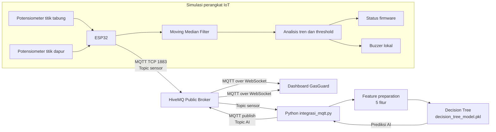

# Arsitektur Sistem GasGuard

## 1. Gambaran Umum

GasGuard adalah prototipe IoT untuk memantau dua titik pembacaan, yaitu area tabung LPG dan area dapur. ESP32 membaca kedua input analog, melakukan pemrosesan data, menentukan status sistem, dan mengendalikan buzzer lokal. Data sensor dikirim ke broker MQTT HiveMQ.

Pada pengembangan AI, sebuah program Python berjalan sebagai layanan terpisah. Program tersebut menerima data sensor dari MQTT, menyusun lima fitur sesuai model Decision Tree, menjalankan prediksi, lalu menerbitkan hasilnya ke topic MQTT khusus AI. Dashboard web menerima data sensor dan hasil prediksi AI secara terpisah.

**Pemisahan tanggung jawab:** status dari firmware tetap menjadi dasar kendali buzzer. Prediksi Decision Tree menjadi informasi klasifikasi tambahan pada dashboard dan tidak menggantikan logika keselamatan firmware.

## 2. Diagram Arsitektur

## 3. Alur Data

1. Dua potensiometer pada rangkaian Wokwi digunakan sebagai simulasi input analog untuk titik tabung dan titik dapur.
2. ESP32 membaca nilai analog pada GPIO 34 dan GPIO 35.
3. Firmware menerapkan Moving Median Filter dengan ukuran jendela lima sampel.
4. Firmware menghitung tren perubahan hasil filter dan menentukan status AMAN, WASPADA, atau BAHAYA berdasarkan threshold serta aturan tren.
5. Firmware mengendalikan buzzer pada GPIO 25 berdasarkan status firmware.
6. ESP32 menerbitkan payload JSON ke HiveMQ melalui MQTT TCP port 1883.
7. Python `integrasi_mqtt.py` berlangganan topic sensor, memvalidasi payload, mengambil nilai filter dan tren, lalu membentuk lima fitur input model.
8. Python memanggil model `decision_tree_model.pkl` untuk menghasilkan kelas AMAN, WASPADA, atau BAHAYA.
9. Python menyimpan catatan prediksi ke `ai_prediction_log.csv` dan menerbitkan hasilnya ke topic AI.
10. Dashboard menerima topic sensor dan topic AI melalui MQTT over WebSocket, lalu menampilkan status firmware dan prediksi AI pada bagian yang berbeda.

## 4. Komponen dan Fungsi

| Komponen | Fungsi |
|---|---|
| ESP32 | Membaca input analog, menjalankan filter dan aturan status, mengendalikan buzzer, serta mengirim data MQTT |
| Potensiometer titik tabung | Menyimulasikan input sensor pada area tabung LPG di Wokwi |
| Potensiometer titik dapur | Menyimulasikan input sensor pada area dapur di Wokwi |
| Moving Median | Mengolah lima sampel untuk menghasilkan nilai filter |
| Threshold dan analisis tren | Menentukan status firmware |
| Buzzer | Memberikan alarm lokal berdasarkan status firmware |
| HiveMQ | Broker publik yang meneruskan pesan MQTT |
| Python + Paho-MQTT | Menerima data sensor, mengolah fitur, menjalankan model, dan menerbitkan prediksi |
| Decision Tree | Mengklasifikasikan lima fitur menjadi AMAN, WASPADA, atau BAHAYA |
| Dashboard web | Menampilkan nilai sensor, status firmware, indikator alarm, dan hasil AI |

## 5. Konfigurasi Komunikasi MQTT

| Pengaturan | Nilai |
|---|---|
| Broker | `broker.hivemq.com` |
| MQTT TCP ESP32/Python | `1883` |
| MQTT WebSocket dashboard | `ws://broker.hivemq.com:8000/mqtt` |
| Topic sensor | `gasguard/kelompok8/device01/sensor/data` |
| Topic prediksi AI | `gasguard/kelompok8/device01/ai/prediction` |
| Publisher topic sensor | ESP32 |
| Subscriber topic sensor | Python dan dashboard |
| Publisher topic AI | Python |
| Subscriber topic AI | Dashboard |

Topic AI merupakan topic tambahan yang digunakan oleh program integrasi. Topic tersebut tidak menggantikan topic sensor firmware.

## 6. Pemrosesan dan Peran AI

Model Decision Tree menerima lima fitur dengan nama dan urutan berikut:

1. `filter_tabung`
2. `filter_dapur`
3. `selisih_sensor`
4. `tren_tabung`
5. `tren_dapur`

Python mengambil `adc_filter` dan `tren` dari objek `sensor_tabung` serta `sensor_dapur` pada payload ESP32. Fitur `selisih_sensor` dihitung ulang oleh Python menggunakan rumus:

`filter_tabung - filter_dapur`

Perhitungan ulang diperlukan karena field `selisih_sensor` yang dikirim firmware menggunakan nilai absolut, sedangkan feature engineering dataset menggunakan selisih bertanda. Nilai `selisih_sensor` dari payload firmware tidak digunakan sebagai input model.

## 7. Lingkungan Dashboard

Dashboard dapat dijalankan di laptop menggunakan Live Server atau server HTTP lokal. Untuk penggunaan di HP, file dashboard dapat disajikan dari HP menggunakan Termux dan dibuka melalui browser pada HP yang sama. Dalam kedua cara tersebut, dashboard tetap menerima data dari HiveMQ melalui internet.

## 8. Batasan Sistem

- Rangkaian Wokwi pada proyek ini menggunakan potensiometer sebagai simulasi input analog; pengujian tersebut bukan pengujian sensor MQ-6 fisik.
- Nilai ADC tidak boleh disebut sebagai konsentrasi LPG dalam ppm tanpa sensor, kalibrasi, dan metode konversi yang sesuai.
- Prediksi AI merupakan keluaran model yang dilatih menggunakan dataset proyek. Prediksi AI tidak mengambil alih kendali buzzer.
- Dataset simulasi dan pengujian Wokwi belum membuktikan akurasi deteksi kebocoran LPG pada kondisi nyata.
